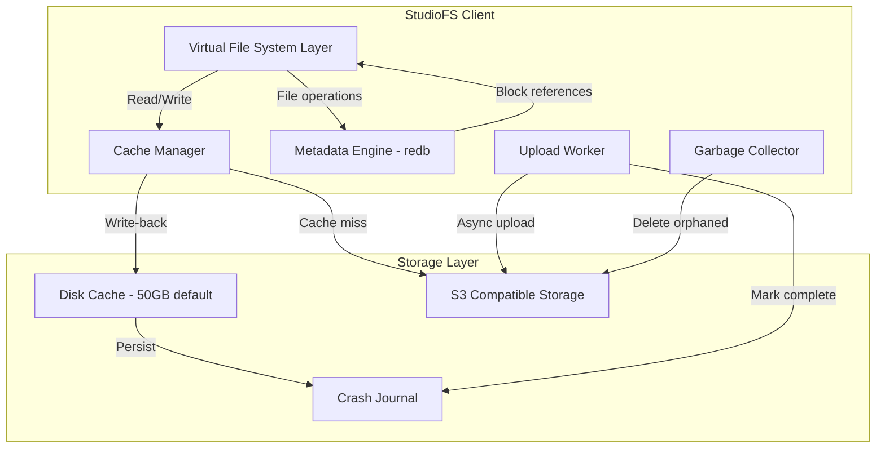
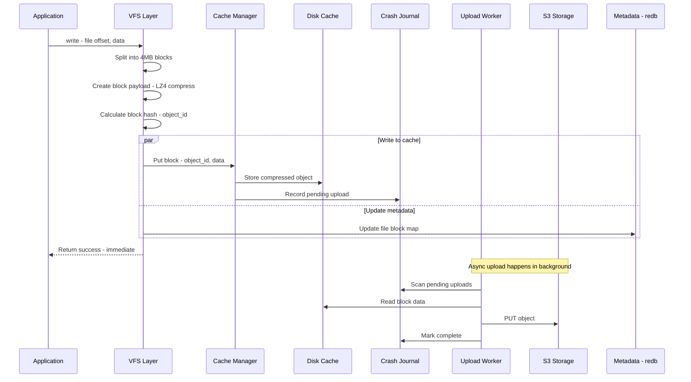
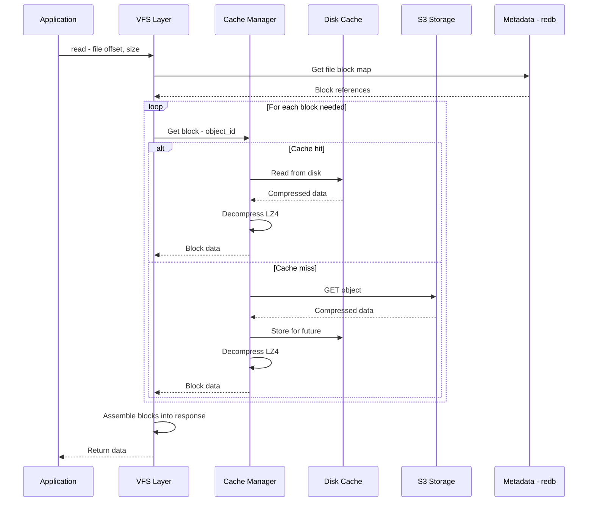
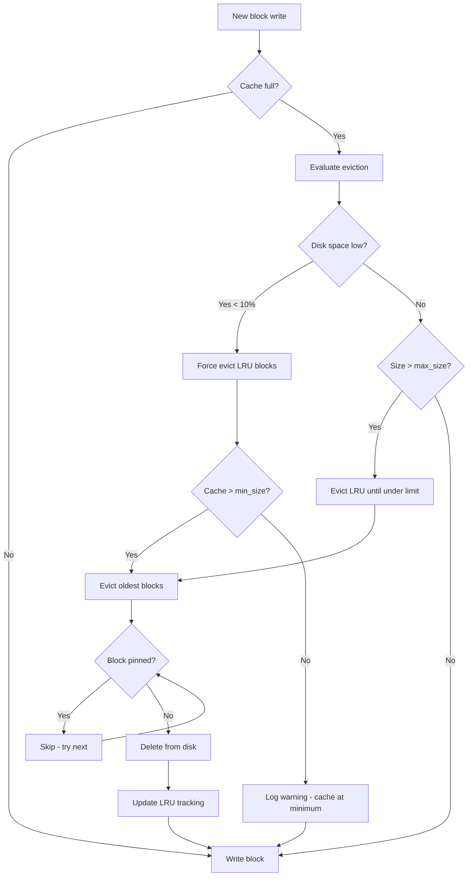
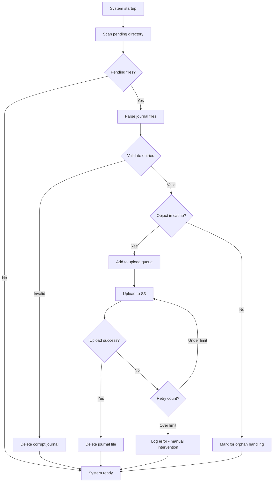
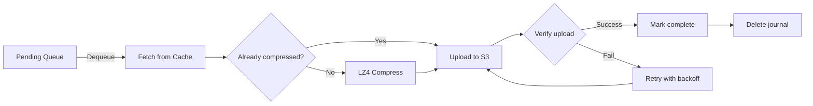
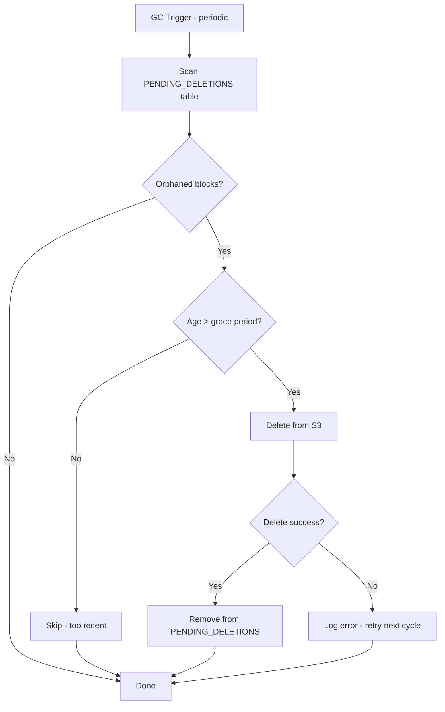

# StudioFS Cache & Storage Architecture Redesign v2

## Executive Summary

This document outlines a clean-slate redesign of StudioFS's data storage, metadata, and caching subsystems. The new architecture is optimized for VFX/post-production workloads with:

- **Immutable block storage** with content-addressable S3 objects
- **Write-back caching** with 50GB default, range-based eviction
- **Crash recovery** via persistent journaling
- **Block-level deduplication** for efficient storage

---

## 1. Architecture Overview

### 1.1 System Components



### 1.2 Data Flow - Write Path



### 1.3 Data Flow - Read Path



---

## 2. Metadata Schema - redb

### 2.1 Table Definitions

```rust
// === Core Tables ===

/// File/directory attributes - key: inode number
const ATTRIBUTES: TableDefinition<u64, InodeAttr> = TableDefinition::new("attributes");

/// Directory entries - key: parent_ino + name hash
/// Enables O(1) lookup by path component
const DIRECTORY_MAP: TableDefinition<(u64, u64), DirEntryValue> = 
    TableDefinition::new("directory_map");

/// File to block mapping - key: inode + block_index
/// Value: BlockRef pointing to S3 object
const FILE_BLOCKS: TableDefinition<(u64, u32), BlockRef> = 
    TableDefinition::new("file_blocks");

/// Pending deletions for garbage collection
/// Key: object_id - Value: deletion_timestamp
const PENDING_DELETIONS: TableDefinition<u64, i64> = 
    TableDefinition::new("pending_deletions");

/// Volume configuration
const FORMAT_INFO: TableDefinition<&str, FormatInfo> = 
    TableDefinition::new("format_info");

/// Counters: next_inode, next_block_id, used_space, total_inodes
const COUNTERS: TableDefinition<&str, u64> = 
    TableDefinition::new("counters");
```

**Note:** No deduplication = no reference counting. Each block belongs to exactly one file position.

### 2.2 Data Structures

```rust
/// Inode attributes - stored in ATTRIBUTES table
#[derive(Debug, Clone, Serialize, Deserialize)]
pub struct InodeAttr {
    pub ino: u64,
    pub kind: FileType,        // File, Directory, Symlink
    pub mode: u16,             // Unix permissions
    pub uid: u32,
    pub gid: u32,
    pub size: u64,             // File size in bytes
    pub nlink: u32,            // Hard link count
    pub mtime: i64,            // Modification time - unix timestamp nanos
    pub ctime: i64,            // Change time
    pub atime: i64,            // Access time
    pub parent: u64,           // Parent inode
}

/// Directory entry value - stored in DIRECTORY_MAP
#[derive(Debug, Clone, Serialize, Deserialize)]
pub struct DirEntryValue {
    pub ino: u64,
    pub kind: FileType,
}

/// Block reference - stored in FILE_BLOCKS
/// Points to an immutable S3 object containing compressed data
#[derive(Debug, Clone, Serialize, Deserialize)]
pub struct BlockRef {
    pub object_id: u64,        // Sequential block ID (not a hash)
    pub offset: u32,           // Offset within the block - for partial blocks
    pub length: u32,           // Length of valid data
    pub flags: BlockFlags,     // Compression, encryption flags
}

bitflags::bitflags! {
    #[derive(Serialize, Deserialize)]
    pub struct BlockFlags: u8 {
        const COMPRESSED_LZ4 = 0x01;
        const PARTIAL_BLOCK = 0x02;  // Not a full block
    }
}
```

### 2.3 Key Design Decisions

1. **Sequential block IDs**: Blocks use sequential IDs (not content hashes):
   - Simpler and faster than content-addressing
   - No deduplication overhead
   - Each block belongs to exactly one file position
   - Immutable objects (never modified, only created/deleted)

2. **No reference counting**: Each block has a single owner (file + block_index):
   - When file is deleted, all its blocks go to `PENDING_DELETIONS`
   - When file is overwritten, old blocks go to `PENDING_DELETIONS`
   - Simpler than reference counting, no race conditions

3. **No embedded metadata in S3**: All file structure is in redb, S3 only stores raw data blocks

---

## 3. S3 Object Format

### 3.1 Object Structure

```
+------------------+
| Object Header    |  32 bytes fixed
+------------------+
| LZ4 Compressed   |  Variable length
| Block Data       |
+------------------+
| Footer Checksum  |  8 bytes - optional
+------------------+
```

### 3.2 Header Specification

```rust
/// S3 Object Header - 32 bytes fixed
/// Little-endian encoding
#[repr(C, packed)]
pub struct ObjectHeader {
    /// Magic bytes: "STFS" (0x53 0x54 0x46 0x53)
    pub magic: [u8; 4],
    
    /// Format version: currently 2
    pub version: u16,
    
    /// Flags: compression type, etc.
    pub flags: ObjectFlags,
    
    /// Original uncompressed size
    pub original_size: u32,
    
    /// Compressed size (excluding header)
    pub compressed_size: u32,
    
    /// XXH64 checksum of ORIGINAL data
    pub checksum: u64,
    
    /// Reserved for future use
    pub reserved: [u8; 6],
}

bitflags::bitflags! {
    pub struct ObjectFlags: u16 {
        const LZ4_COMPRESSED = 0x0001;
        const HAS_FOOTER = 0x0002;
        const ENCRYPTED = 0x0004;  // Future use
    }
}
```

### 3.3 Object Naming Convention

```
Key format: {volume_uuid}/blocks/{prefix}/{object_id}

Where:
- volume_uuid: UUID of the StudioFS volume
- prefix: First 4 hex chars of object_id for S3 partition distribution
- object_id: 16-char hex sequential block ID

Example: 550e8400-e29b-41d4-a716-446655440000/blocks/0001/0000000000001234
```

### 3.4 Block Size Strategy

- **Configurable block size**: Set at volume initialization (in MB)
- **Default block size**: 4 MiB (4,194,304 bytes)
- **Partial blocks**: Last block of file may be smaller
- **Compression**: LZ4 frame format for fast decompression
- **No encryption**: Per requirements, no encryption overhead

### 3.5 Volume Configuration

```rust
/// Volume format information - stored in FORMAT_INFO table
#[derive(Debug, Clone, Serialize, Deserialize)]
pub struct FormatInfo {
    pub name: String,
    pub uuid: String,
    pub endpoint: String,
    pub bucket: String,
    pub access_key: String,
    pub secret_key: String,
    pub region: String,
    /// Block size in bytes - configurable at init
    pub block_size: u32,  // e.g., 4194304 for 4MB, 1048576 for 1MB
    pub chunk_size: u64,  // Deprecated - kept for compatibility
}
```

---

## 4. Cache Architecture

### 4.1 Cache Directory Structure

```
$HOME/.studiofs/cache/{volume_uuid}/
    objects/                    # Compressed object storage
        ab/                     # First 2 hex chars
            cd/                 # Next 2 hex chars
                abcd1234...     # Object file (full hash as filename)
    pending/                    # Upload journal
        {ino}_{offset}_{object_id}.journal
    metadata.db                 # Cache-local metadata (optional)
    cache.lock                  # Lock file for exclusive access
```

### 4.2 Cache Manager Design

```rust
pub struct CacheManager {
    /// Disk cache for persistent storage (default: 50 GB)
    disk_cache: Arc<DiskCache>,
    
    /// In-memory LRU for hot blocks (fixed: 1 GB)
    memory_cache: Arc<MemoryCache>,
    
    /// Write-back queue with journaling
    writeback: Arc<WritebackQueue>,
    
    /// Upload worker handle
    upload_worker: JoinHandle<()>,
    
    /// Configuration
    config: CacheConfig,
}

pub struct CacheConfig {
    /// Maximum disk cache size in bytes (default: 50 GB)
    pub max_disk_size: u64,
    
    /// Fixed memory cache size (default: 1 GB)
    pub memory_size: usize,
    
    /// Minimum disk cache size before eviction stops (default: 1 GB)
    pub min_disk_size: u64,
    
    /// Target free disk space ratio (default: 0.10 = 10%)
    pub target_free_ratio: f64,
    
    /// Cache directory path
    /// Default: $HOME/.studiofs/cache/{volume_uuid}
    pub cache_dir: PathBuf,
    
    /// Maximum concurrent uploads (default: 32)
    pub max_concurrent_uploads: usize,
    
    /// Upload retry count (default: 3)
    pub upload_retries: u32,
}
```

### 4.3 Cache Operations

```rust
impl CacheManager {
    /// Write a block to cache - returns immediately
    pub async fn put(&self, object_id: u64, data: &[u8]) -> Result<()> {
        // 1. Write to disk cache
        self.disk_cache.put(object_id, data).await?;
        
        // 2. Add to writeback queue with journal
        self.writeback.submit(object_id).await?;
        
        // 3. Update memory cache for immediate reads
        self.memory_cache.put(object_id, data);
        
        Ok(())
    }
    
    /// Read a block from cache - may fetch from S3
    pub async fn get(&self, object_id: u64) -> Result<Bytes> {
        // 1. Check memory cache
        if let Some(data) = self.memory_cache.get(object_id) {
            return Ok(data);
        }
        
        // 2. Check disk cache
        if let Some(data) = self.disk_cache.get(object_id).await? {
            // Promote to memory cache
            self.memory_cache.put(object_id, &data);
            return Ok(data);
        }
        
        // 3. Fetch from S3
        let data = self.fetch_from_s3(object_id).await?;
        
        // 4. Store in disk cache
        self.disk_cache.put(object_id, &data).await?;
        
        // 5. Store in memory cache
        self.memory_cache.put(object_id, &data);
        
        Ok(data)
    }
}
```

### 4.4 Eviction Policy



### 4.5 Eviction Algorithm

```rust
impl DiskCache {
    /// Evict blocks to make room for new data
    async fn evict_for(&self, needed_bytes: u64) -> Result<()> {
        let mut evicted = 0u64;
        let min_size = self.config.min_size;
        
        loop {
            // Check if we have enough space
            if self.current_size() + needed_bytes <= self.config.max_size {
                // Check disk space
                if !self.is_disk_space_critical() {
                    break;
                }
            }
            
            // Don't evict below minimum
            if self.current_size() - evicted <= min_size {
                tracing::warn!("Cache at minimum size, cannot evict further");
                break;
            }
            
            // Find LRU candidate
            let candidate = self.find_lru_candidate()?;
            
            match candidate {
                Some(object_id) => {
                    // Skip pinned blocks (pending upload)
                    if self.is_pinned(object_id) {
                        continue;
                    }
                    
                    // Delete the file
                    self.delete_object(object_id).await?;
                    evicted += self.get_object_size(object_id);
                    self.remove_from_tracking(object_id);
                }
                None => break, // No evictable blocks
            }
        }
        
        Ok(())
    }
    
    /// Check if disk space is critically low
    fn is_disk_space_critical(&self) -> bool {
        let (free, total) = get_disk_space(&self.config.cache_dir);
        let ratio = free as f64 / total as f64;
        ratio < self.config.target_free_ratio
    }
}
```

---

## 5. Crash Recovery

### 5.1 Journal Format

```
File: {ino}_{offset}_{object_id}.journal

Content format (binary):
+------------------+
| Journal Header   |  16 bytes
+------------------+
| Object ID        |  8 bytes
+------------------+
| File Offset      |  8 bytes
+------------------+
| Inode Number     |  8 bytes
+------------------+
| Status           |  1 byte: 0=pending, 1=uploading, 2=complete
+------------------+
| Timestamp        |  8 bytes - creation time
+------------------+
```

### 5.2 Recovery Flow



### 5.3 Recovery Implementation

```rust
impl WritebackQueue {
    /// Recover pending uploads from journal on startup
    pub async fn recover(&self) -> Result<Vec<PendingUpload>> {
        let mut pending = Vec::new();
        let pending_dir = self.config.cache_dir.join("pending");
        
        for entry in fs::read_dir(&pending_dir)? {
            let entry = entry?;
            let path = entry.path();
            
            // Parse journal file
            match self.parse_journal(&path) {
                Ok(journal) => {
                    // Verify object exists in cache
                    if self.disk_cache.exists(journal.object_id) {
                        pending.push(PendingUpload {
                            object_id: journal.object_id,
                            offset: journal.offset,
                            ino: journal.ino,
                            retries: 0,
                        });
                    } else {
                        // Object missing - orphan journal
                        tracing::warn!("Orphan journal: {:?} - object missing", path);
                        fs::remove_file(&path)?;
                    }
                }
                Err(e) => {
                    tracing::error!("Corrupt journal {:?}: {}", path, e);
                    fs::remove_file(&path)?;
                }
            }
        }
        
        if !pending.is_empty() {
            tracing::info!("Recovered {} pending uploads from crash", pending.len());
        }
        
        Ok(pending)
    }
}
```

---

## 6. Upload Worker

### 6.1 Upload Pipeline



### 6.2 Concurrent Upload Design

```rust
impl UploadWorker {
    pub async fn run(&self, mut rx: UnboundedReceiver<PendingUpload>) {
        let semaphore = Arc::new(Semaphore::new(self.config.max_concurrent_uploads));
        
        while let Some(upload) = rx.recv().await {
            let permit = semaphore.clone().acquire_owned().await.unwrap();
            let worker = self.clone();
            
            tokio::spawn(async move {
                if let Err(e) = worker.upload_with_retry(upload).await {
                    tracing::error!("Upload failed after retries: {}", e);
                }
                drop(permit);
            });
        }
    }
    
    async fn upload_with_retry(&self, upload: PendingUpload) -> Result<()> {
        let mut retries = 0;
        let mut delay = Duration::from_secs(1);
        
        loop {
            // Read from cache
            let data = self.cache.get(upload.object_id).await?;
            
            // Upload to S3
            match self.store.put_object(&upload.object_id, data).await {
                Ok(_) => {
                    // Mark complete
                    self.writeback.mark_complete(upload.object_id).await?;
                    return Ok(());
                }
                Err(e) => {
                    retries += 1;
                    if retries > self.config.upload_retries {
                        return Err(e);
                    }
                    
                    tracing::warn!("Upload retry {} for {}: {}", retries, upload.object_id, e);
                    tokio::time::sleep(delay).await;
                    delay *= 2; // Exponential backoff
                }
            }
        }
    }
}
```

---

## 7. Garbage Collection

### 7.1 GC Flow



### 7.2 Block Lifecycle

```rust
impl MetadataEngine {
    /// Mark all blocks of a file for deletion
    /// Called when file is deleted or truncated
    pub fn mark_file_blocks_for_deletion(&self, ino: u64) -> Result<Vec<u64>> {
        let tx = self.db.begin_write()?;
        let deleted_blocks = {
            let mut file_blocks = tx.open_table(FILE_BLOCKS)?;
            let mut pending = tx.open_table(PENDING_DELETIONS)?;
            
            // Find all blocks for this inode
            let prefix = (ino, 0);
            let mut blocks_to_delete = Vec::new();
            
            // Iterate all blocks for this inode
            for entry in file_blocks.range(prefix..)? {
                let (key, value) = entry?;
                let (key_ino, _) = key.value();
                if key_ino != ino { break; }
                blocks_to_delete.push(value.value().object_id);
            }
            
            // Remove from file_blocks and add to pending_deletions
            for object_id in &blocks_to_delete {
                pending.insert(*object_id, current_timestamp())?;
            }
            
            // Remove all entries for this inode from file_blocks
            // (done via range deletion in redb)
            blocks_to_delete
        };
        tx.commit()?;
        Ok(deleted_blocks)
    }
    
    /// Mark old blocks for deletion when file is overwritten
    pub fn update_file_block(&self, ino: u64, block_idx: u32, new_block: BlockRef) -> Result<()> {
        let tx = self.db.begin_write()?;
        {
            let mut file_blocks = tx.open_table(FILE_BLOCKS)?;
            let mut pending = tx.open_table(PENDING_DELETIONS)?;
            
            let key = (ino, block_idx);
            
            // If there's an existing block, mark it for deletion
            if let Some(old_block) = file_blocks.get(key)? {
                pending.insert(old_block.value().object_id, current_timestamp())?;
            }
            
            // Insert new block
            file_blocks.insert(key, new_block)?;
        }
        tx.commit()?;
        Ok(())
    }
}
```

---

## 8. Implementation Plan

### 8.1 Crate Structure

```
crates/
  studiofs-meta/         # Metadata engine (redb)
    src/
      lib.rs
      schema.rs         # Table definitions
      engine.rs         # Metadata operations
      types.rs          # Data structures
      
  studiofs-cache/       # Cache management
    src/
      lib.rs
      manager.rs        # CacheManager
      disk.rs           # DiskCache with LRU
      memory.rs         # In-memory LRU
      writeback.rs      # Writeback queue + journal
      recovery.rs       # Crash recovery
      eviction.rs       # Eviction policies
      
  studiofs-data/        # S3 storage
    src/
      lib.rs
      object.rs         # Object format
      store.rs          # S3 operations
      compress.rs       # LZ4 compression
      
  studiofs-vfs/         # Virtual filesystem
    src/
      lib.rs
      vfs.rs            # Core VFS operations
      read.rs           # Read path
      write.rs          # Write path
      flush.rs          # Flush/commit logic
```

### 8.2 Migration Steps

1. **Phase 1: Core Types**
   - Define new data structures in `studiofs-meta/types.rs`
   - Define object format in `studiofs-data/object.rs`
   - No backward compatibility needed

2. **Phase 2: Metadata Engine**
   - Implement new redb schema
   - Reference counting logic
   - GC integration

3. **Phase 3: Cache Layer**
   - Rewrite `DiskCache` with new eviction
   - Implement crash journal
   - Recovery logic

4. **Phase 4: VFS Integration**
   - Rewrite write path with immutable blocks
   - Implement read path with new cache
   - Flush/commit logic

5. **Phase 5: Testing**
   - Unit tests for each component
   - Integration tests for crash recovery
   - Performance benchmarks

---

## 9. Configuration

```rust
/// Default disk cache size: 50 GB
pub const DEFAULT_DISK_CACHE_SIZE: u64 = 50 * 1024 * 1024 * 1024;

/// Fixed memory cache size: 1 GB
pub const MEMORY_CACHE_SIZE: usize = 1 * 1024 * 1024 * 1024;

/// Minimum disk cache size: 1 GB
pub const MIN_DISK_CACHE_SIZE: u64 = 1 * 1024 * 1024 * 1024;

/// Target free disk space: 10-15%
pub const DEFAULT_FREE_RATIO: f64 = 0.10;

/// Default block size: 4 MB (configurable at init)
pub const DEFAULT_BLOCK_SIZE_MB: u32 = 4;

/// Maximum concurrent uploads
pub const MAX_CONCURRENT_UPLOADS: usize = 32;

/// Upload retry count
pub const UPLOAD_RETRIES: u32 = 3;

/// GC grace period: 1 hour
pub const GC_GRACE_PERIOD_SECS: i64 = 3600;

/// GC interval: 10 minutes
pub const GC_INTERVAL_SECS: u64 = 600;
```

---

## 10. Key Differences from Current Implementation

| Aspect | Current | New Design |
|--------|---------|------------|
| Object mutability | Objects can be overwritten | Immutable objects only |
| Metadata location | Embedded in objects | Pure redb, no S3 metadata |
| Block addressing | Slice-based with overlaps | Direct block references |
| Block IDs | Content hash (XXH64) | Sequential IDs (simpler) |
| Crash recovery | Basic journal | Full journal + recovery |
| Eviction policy | Size-based only | Size + disk space + minimum |
| Deduplication | None | None (simpler, faster) |
| Upload ordering | FIFO per file | Parallel unordered |
| Cache location | Custom path | `$HOME/.studiofs/cache/{uuid}` |
| Block size | Fixed 4MB | Configurable at init (MB) |
| Memory cache | Proportional | Fixed 1GB |

---

## 11. Open Questions

1. **Read-ahead strategy**: How aggressive should prefetch be for sequential video reads?

2. **Encryption future**: Should we reserve space in the header for future encryption support?

3. **Block size migration**: If user wants to change block size after init, should we support migration?

---

## 12. References

- [LucidLink-like design doc](../ideas/LucidLink-like.md)
- [JuiceFS architecture](https://juicefs.com/docs/community/architecture)
- [redb documentation](https://docs.rs/redb)
- [LZ4 frame format](https://github.com/lz4/lz4/blob/dev/doc/lz4_Frame_format.md)